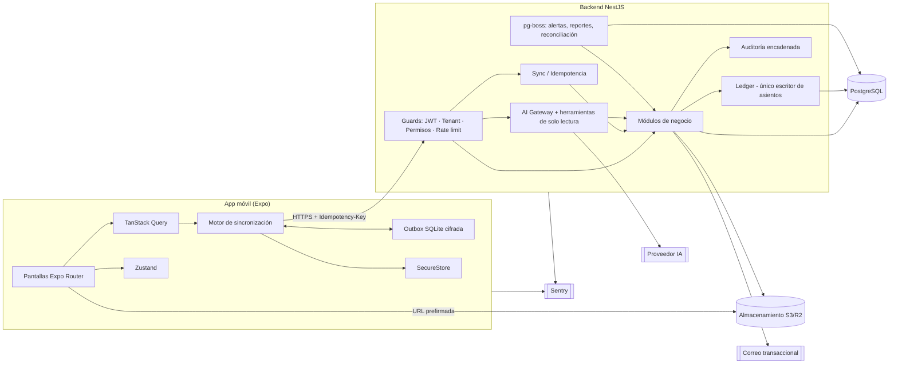
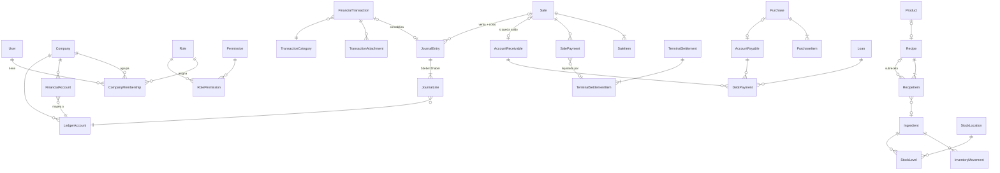

# Finanzas Pro — Fase 0: Análisis y diseño

> Estado: **borrador para aprobación** · Fecha: 2026-10-25 · Versión 0.1
> Ningún módulo está implementado todavía. Este documento define qué se va a construir, cómo y bajo qué reglas.

---

## 1. Resumen de requisitos y alcance del MVP

### 1.1 Problema
Propietarios y administradores de PyMEs (inicialmente alimentos y bebidas) necesitan saber desde el teléfono cuánto dinero tienen, cuánto ganan realmente, qué deben, qué les deben y cuánto les cuesta producir, con cifras confiables y auditables.

### 1.2 Principio rector
**Una sola fuente de verdad contable**: todo hecho económico confirmado se traduce en un asiento de partida doble en un libro interno (ledger). Saldos, utilidad, flujo de efectivo y reportes se *derivan* de ese libro; nunca se capturan ni se aceptan desde el cliente.

El usuario **no ve** partida doble: ve "ingreso", "gasto", "venta", "pago", "transferencia". El ledger es un detalle interno que garantiza que una venta con tarjeta que luego se liquida no cuente dos veces como ingreso, que el pago de una deuda no sea un gasto, etc.

### 1.3 Alcance propuesto

| Versión | Contenido | Fases |
|---|---|---|
| **MVP operativo (v0.x, uso interno/piloto)** | Auth, empresas, roles y permisos, cuentas (caja, terminal, banco), movimientos (ingreso, gasto, transferencia), categorías, adjuntos, saldos, auditoría, dashboard básico, captura offline de ingresos/gastos | 1–2 |
| **v1.0 (primera producción)** | + ventas, compras, clientes/proveedores, CxC/CxP, terminales y liquidaciones, inventario con recetas y costeo, estado de resultados gerencial, flujo de efectivo, presupuestos, préstamos, reportes y exportaciones | 3–4 + estabilización parcial |
| **v1.1+** | Nómina, IA (OCR, asistente, análisis, alertas inteligentes, predicción, recomendaciones), integraciones | 4 (nómina), 5, 6 |

Las fases del prompt maestro se respetan; el corte de versiones solo indica qué conviene poner en manos de un negocio piloto primero.

### 1.4 Fuera de alcance (explícito)
- Facturación electrónica CFDI, timbrado, cálculo de declaraciones fiscales.
- Cálculo legal de nómina (ISR, IMSS, INFONAVIT). El módulo de nómina será un **registro gerencial** con deducciones configurables por el usuario.
- Conexión bancaria, POS de terceros, pasarelas de pago (se dejan puertos/adaptadores preparados).
- Almacenamiento de datos de tarjetas o credenciales bancarias.
- Multimoneda con conversión (el campo `currency` existe desde el inicio, pero cada empresa opera en una moneda base en v1).

### 1.5 Supuestos por defecto (se aplican si no se indica otra cosa)
- Moneda base MXN, zona horaria `America/Mexico_City`, idioma es-MX.
- IVA configurable por producto/categoría (tasas iniciales 16 %, 8 %, 0 % y exento **como datos editables**, no como regla legal).
- Costeo de inventario: **promedio ponderado móvil**.
- Estado de resultados en base **devengado**; flujo de efectivo en base **efectivo**.
- Una sucursal por empresa en v1 (el modelo ya soporta `Branch` y varias `StockLocation`).

---

## 2. Arquitectura propuesta y justificación

Se mantiene la arquitectura del prompt maestro. Los únicos ajustes son concreciones, no cambios:

| Capa | Elección | Justificación |
|---|---|---|
| Monorepo | **pnpm workspaces** + Turborepo | Comparte tipos y esquemas Zod entre app y API; builds incrementales. (Alternativa: npm workspaces, ya instalado.) |
| Móvil | Expo SDK estable más reciente, React Native, TypeScript, Expo Router | Requerido; EAS Build para Android/iOS sin Mac local. |
| UI | **React Native Paper** (Material 3) | Mantenida, accesible, temable, componentes de formulario maduros. |
| Gráficas | **victory-native** (Skia) | Rendimiento nativo, mantenida. |
| Estado remoto | TanStack Query | Caché, reintentos, invalidación. |
| Estado global | Zustand | Sesión, empresa activa, preferencias. |
| Formularios | react-hook-form + Zod (esquemas compartidos) | Mismas reglas de validación en cliente y servidor. |
| Local | **expo-sqlite con SQLCipher** | Base local cifrada; clave en `expo-secure-store`. |
| Credenciales | expo-secure-store | Keychain / Keystore. |
| Backend | **NestJS** + TypeScript | Modular, guards/interceptors para tenant y permisos, Swagger integrado. |
| ORM | **Prisma** | Migraciones versionadas, tipos; `Decimal` para dinero; SQL crudo donde se requiera `FOR UPDATE`. |
| BD | PostgreSQL 16+ | Transacciones, `NUMERIC`, índices parciales, RLS opcional. |
| Validación | Zod (`nestjs-zod`) | Esquemas compartidos con la app. |
| Tareas programadas / colas | **pg-boss** | Colas sobre el mismo PostgreSQL: evita Redis en v1. |
| Archivos | Almacenamiento compatible con S3 (Cloudflare R2 o AWS S3) con URLs prefirmadas | Los adjuntos nunca pasan por la BD; acceso temporal. |
| Correo | Proveedor transaccional (p. ej. Resend) tras un puerto `Mailer` | Recuperación de contraseña e invitaciones. |
| IA | Puerto `AiProvider` con adaptador inicial para Claude (Anthropic) | Claves solo en servidor; proveedor intercambiable. Modelo concreto se fija en Fase 5. |
| Observabilidad | Sentry (app + API), logs estructurados con pino y redacción de campos sensibles | Errores sin filtrar secretos. |
| CI | GitHub Actions | Lint, typecheck, pruebas, migraciones contra Postgres de servicio. |
| Despliegue sugerido | API en Render/Railway/Fly.io; Postgres administrado (Neon o Supabase); R2; EAS para móvil | Servicios administrados, entornos dev/staging/prod separados. |

### 2.1 Estructura de repositorio

```
finanzas-pro/
├─ apps/
│  ├─ mobile/            # Expo + Expo Router
│  └─ api/               # NestJS
├─ packages/
│  ├─ shared/            # Esquemas Zod, tipos DTO, enums, permisos, utilidades de dinero
│  └─ config/            # tsconfig, eslint, prettier compartidos
├─ docs/                 # Este documento, ADRs, modelo de datos, runbooks
├─ infra/                # docker-compose (dev), scripts de respaldo/restauración
└─ .github/workflows/
```

### 2.2 Módulos del backend (NestJS)

`auth`, `companies`, `memberships`, `rbac`, `audit`, `ledger` (núcleo contable), `accounts`, `transactions`, `categories`, `attachments`, `parties` (clientes/proveedores), `sales`, `purchases`, `receivables-payables`, `terminals`, `inventory`, `recipes`, `loans`, `budgets`, `payroll`, `reports`, `forecasts`, `alerts`, `ai`, `sync`, `jobs`.

Regla: **solo el módulo `ledger` escribe asientos**. Los demás módulos llaman a `LedgerService.post(...)` dentro de la misma transacción de BD que su documento de negocio.

---

## 3. Diagrama de componentes



---

## 4. Modelo de datos inicial

### 4.1 Convenciones
- PK: `UUID` (v7, generable en el dispositivo; ordenable por tiempo).
- Toda entidad de negocio tiene `company_id` (FK, `NOT NULL`, indexado) y `created_at`, `created_by`, `updated_at`, `updated_by`, `version` (entero para concurrencia optimista).
- Dinero: `NUMERIC(19,4)`. Cantidades de inventario: `NUMERIC(19,6)`. Nunca `float`.
- Borrado: entidades financieras **nunca se borran físicamente**; se anulan (`status = VOIDED`) con asiento de reversa. Catálogos usan `archived_at` (borrado lógico).
- Enums como tipos de Postgres o `CHECK`.

### 4.2 Núcleo contable (nuevo respecto al prompt, ver justificación en §6)

| Entidad | Propósito |
|---|---|
| `LedgerAccount` | Plan de cuentas interno por empresa (Caja, Terminal por liquidar, Banco, CxC, Inventario, IVA trasladado, IVA acreditable, CxP, Préstamos, Capital, Retiros, Ventas, Descuentos y devoluciones, Costo de ventas, Gastos por categoría, Comisiones, Intereses, Sueldos por pagar…). Sembrado automáticamente; el usuario no lo administra salvo el contador. |
| `JournalEntry` | Asiento: fecha contable, tipo de origen (`source_type`, `source_id`), estado (`POSTED`, `REVERSED`), `reverses_entry_id`. Restricción: `UNIQUE(company_id, source_type, source_id, purpose)` → una operación no puede contabilizarse dos veces. |
| `JournalLine` | Línea: `ledger_account_id`, `debit`, `credit` (uno de los dos > 0), dimensiones opcionales (`financial_account_id`, `category_id`, `party_id`, `branch_id`, `cost_center_id`, `project_id`). Trigger/verificación: Σdebe = Σhaber por asiento. |

### 4.3 Entidades del prompt y su papel

**Identidad y acceso**
- `User` (email único, hash Argon2id, estado, `email_verified_at`).
- `Session` / `RefreshToken` (hash del token, dispositivo, expiración, `revoked_at`, `family_id` para detectar reuso).
- `PasswordResetToken`, `Invitation` (token hasheado, rol propuesto, expiración).
- `Company` (moneda base, zona horaria, configuración fiscal y de módulos, `is_demo`).
- `Branch`, `CostCenter`, `Project` (dimensiones opcionales).
- `CompanyMembership` (user × company, `role_id`, estado `ACTIVE/REVOKED`).
- `Role` (sistema: Propietario, Administrador, Contador, Empleado; o personalizado por empresa), `Permission` (`module:action`), `RolePermission`.

**Finanzas**
- `FinancialAccount` (tipo `CASH | TERMINAL | BANK | DIGITAL_WALLET`, moneda, saldo inicial, `ledger_account_id`). El saldo **no se almacena como verdad**: se deriva de `JournalLine`; existe `AccountBalanceSnapshot` como caché reconstruible.
- `TransactionCategory` (árbol categoría/subcategoría, naturaleza `INCOME | EXPENSE | COGS | OTHER`, mapeo a `LedgerAccount`).
- `FinancialTransaction`: el "movimiento" que ve el usuario (ingreso, gasto, transferencia, aportación, retiro, ajuste). Campos del §6 del prompt; estado `DRAFT | PENDING_REVIEW | POSTED | VOIDED`; `journal_entry_id` al contabilizarse; `client_op_id` único.
- `TransactionAttachment` (clave S3, `sha256`, mime, tamaño, estado OCR). `UNIQUE(company_id, sha256)` para detectar comprobante duplicado (con opción de forzar con justificación auditada).

**Comercial**
- `Customer`, `Supplier` (o tabla única `Party` con rol; se propone `Party` + vistas para simplificar CxC/CxP).
- `Product` (tipo `RECIPE | RESALE | SERVICE`, precio, impuesto, `recipe_id` opcional).
- `Sale` / `SaleItem` (precio y totales **recalculados en servidor**; estado `DRAFT | POSTED | VOIDED`; `payment_status`).
- `SalePayment` (cobro: cuenta, método, importe, comisión estimada).
- `SaleReturn` / `SaleReturnItem` (devoluciones como documento propio, no edición de la venta).
- `Purchase` / `PurchaseItem` (ítem → `Ingredient`/`Product`/categoría de gasto).
- `TerminalSettlement` / `TerminalSettlementItem` (liquidación de terminal: bruto, comisión, IVA de comisión, neto, cuenta destino; enlaza los cobros que liquida).

**Inventario y recetas**
- `UnitOfMeasure`, `UnitConversion` (globales + por ingrediente, p. ej. 1 caja = 12 piezas).
- `Ingredient` (unidad base, stock mínimo, costo promedio vigente).
- `Recipe` (rendimiento, porciones, merma %, costos adicionales), `RecipeItem` (ingrediente **o** subreceta, cantidad, unidad). Restricción anticíclica validada en servicio.
- `StockLocation`, `StockLevel` (`ingredient × location`: cantidad, costo promedio; fila bloqueada con `FOR UPDATE` al moverse).
- `InventoryMovement` (tipo `PURCHASE | SALE_CONSUMPTION | WASTE | ADJUSTMENT | TRANSFER | RETURN`, cantidad firmada, costo unitario, `source_type/source_id/source_line_id`). `UNIQUE(company_id, source_type, source_line_id, ingredient_id, type)` → no se descuenta dos veces.

**Obligaciones**
- `AccountReceivable`, `AccountPayable` (documento origen, importe original, saldo, vencimiento, estado). El saldo se deriva de `DebtPayment`/`SalePayment`.
- `Loan` (principal, tasa, plazo, calendario), `LoanInstallment`.
- `DebtPayment` (aplica a CxP, CxC o préstamo; desglose `principal`, `interest`, `fees`; cuenta de pago).

**Planeación y personal**
- `Budget` (periodo, dimensión), `BudgetCategory` (línea: categoría, monto, umbrales de alerta).
- `FinancialForecast` (+ `ForecastPoint`: fecha, escenario, valor, banda inferior/superior, supuestos JSON, método).
- `Employee` (datos sensibles en columnas separadas, acceso restringido), `PayrollPeriod`, `PayrollEntry` (percepciones/deducciones configurables, devengado vs pagado).

**Sistema**
- `Alert` (origen `RULE | AI`, severidad, regla, evidencia JSON, estado).
- `AIConversation`, `AIMessage`, `AIAuditRecord` (herramientas invocadas, parámetros, tokens, costo, latencia; sin datos crudos de documentos).
- `AuditLog` (append-only, `prev_hash` + `hash` encadenado por empresa).
- `SyncOperation` (`client_op_id` único por empresa, tipo, payload hash, resultado, estado).
- `PeriodLock` (fecha hasta la que el periodo está cerrado).

### 4.4 Relaciones principales



El esquema Prisma completo, índices y migraciones se generarán en la Fase 1 (identidad) y se ampliarán por fase.

---

## 5. Flujos de registro (reglas de contabilización)

Notación: `D` = cargo (debe), `H` = abono (haber). Todo asiento se crea en la **misma transacción de BD** que el documento que lo origina.

### 5.1 Ingreso no relacionado con ventas (p. ej. reembolso, otros ingresos)
1. Usuario captura importe, cuenta, categoría, fecha, comprobante opcional.
2. Servidor valida permisos, categoría de naturaleza `INCOME`, periodo no cerrado.
3. Si el rol requiere revisión → `PENDING_REVIEW` (no afecta saldos confirmados). Si no → `POSTED`.
4. Asiento: `D Cuenta financiera` / `H Otros ingresos (categoría)`.

### 5.2 Gasto
1. Captura manual o con foto (OCR propone datos; el usuario confirma).
2. Verificación de duplicados: hash del archivo + (importe, fecha ±1 día, proveedor) como sospecha.
3. Asiento contado: `D Gasto (categoría)` + `D IVA acreditable` (si aplica) / `H Cuenta financiera`.
4. A crédito: se registra como **Compra** con `AccountPayable` (ver 5.4).

### 5.3 Venta
1. Captura de partidas (producto, cantidad, descuento). El cliente envía **solo IDs y cantidades**; precios, impuestos y totales se recalculan en servidor desde el catálogo vigente (un precio manual requiere permiso `sales:override_price` y queda auditado).
2. Al confirmar (`POSTED`), en una transacción:
   - **Asiento de venta**: `D Por cobrar del método` (Caja / Terminal por liquidar / CxC) por el total / `H Ventas` (subtotal neto de descuento) / `H IVA trasladado`.
   - **Asiento de costo**: para cada partida con receta, explosión de receta → `InventoryMovement` de consumo a costo promedio vigente → `D Costo de ventas` / `H Inventario`.
3. Pago parcial: la porción no cobrada genera `AccountReceivable` (`D CxC`).
4. Anulación: asientos de reversa + reingreso de inventario; la venta queda `VOIDED`.
5. Devolución: documento `SaleReturn` → `D Devoluciones sobre ventas` + `D IVA trasladado` / `H Caja o CxC`; reingreso a inventario opcional (merma si no se reaprovecha).

### 5.4 Compra
1. Captura proveedor, partidas (ingrediente/producto/servicio), costos, IVA, vencimiento.
2. Asiento: `D Inventario` (o `D Gasto`) + `D IVA acreditable` / `H Caja` (contado) o `H CxP` (crédito).
3. Inventario: `InventoryMovement` de entrada; recálculo de costo promedio ponderado:
   `nuevo_costo = (cant_actual × costo_actual + cant_entrada × costo_entrada) / (cant_actual + cant_entrada)`.

### 5.5 Pagos y cobros de obligaciones
- **Cobro de CxC**: `D Caja/Banco` / `H CxC`. *No es ingreso nuevo* (ya se reconoció en la venta).
- **Pago de CxP**: `D CxP` / `H Caja/Banco`. *No es gasto nuevo*.
- **Liquidación de terminal**: `D Banco` (neto) + `D Comisiones bancarias` + `D IVA acreditable de comisión` / `H Terminal por liquidar` (bruto). *No es ingreso nuevo*.
- **Préstamo recibido**: `D Banco` / `H Préstamos por pagar`. *No es ingreso*.
- **Pago de préstamo**: `D Préstamos por pagar` (principal) + `D Gasto por intereses` + `D Comisiones` / `H Banco`. *El principal no es gasto*.
- **Transferencia entre cuentas**: `D Cuenta destino` / `H Cuenta origen`. *Ni ingreso ni gasto*.
- **Aportación / retiro de socios**: `D Caja` / `H Capital` y `D Retiros` / `H Caja`. *No afectan utilidad*.
- **Nómina**: devengo `D Gasto de nómina` / `H Sueldos por pagar`; pago `D Sueldos por pagar` / `H Caja`. Anticipo: `D Anticipos a empleados` / `H Caja`.

### 5.6 Definiciones de cifras (derivadas del ledger)

| Cifra | Definición |
|---|---|
| Saldo contable de una cuenta | Saldo inicial + Σ líneas `POSTED` de su cuenta contable a la fecha. |
| **Dinero disponible** | Σ saldos de cuentas `CASH`, `BANK`, `DIGITAL_WALLET`. Excluye terminal por liquidar (se muestra aparte como "por depositar") y **nunca** suma CxC. |
| Cobros pendientes | Saldo de CxC + Terminal por liquidar. |
| Pagos pendientes | Saldo de CxP + sueldos por pagar + cuotas de préstamo vencidas o próximas. |
| Flujo de efectivo realizado | Σ movimientos `POSTED` en cuentas de efectivo del periodo, clasificados en operación / inversión / financiamiento; excluye transferencias internas. |
| Flujo proyectado | Disponible + cobros esperados por fecha − pagos programados por fecha (+ pronóstico de ventas/gastos si existe, etiquetado como estimación). |
| Ingresos netos | Ventas − descuentos − devoluciones (IVA excluido). |
| Costo de ventas | Σ `D Costo de ventas` del periodo. |
| Utilidad bruta / operativa / neta | Fórmulas del prompt sobre cuentas contables; marcadas como **"estimación gerencial"** si existen partidas `PENDING_REVIEW`, ventas sin receta/costo o periodo no cerrado. |
| Pendientes | Las operaciones `PENDING_REVIEW` y las aún no sincronizadas se muestran en un indicador separado ("+ $X por revisar") y nunca se mezclan con saldos confirmados. |

---

## 6. Reglas para evitar duplicidades y errores contables

1. **Partida doble obligatoria**: cada asiento cuadra (Σdebe = Σhaber); verificación en servicio y restricción diferida en BD.
2. **Un hecho, un asiento**: `UNIQUE(company_id, source_type, source_id, purpose)` en `JournalEntry`.
3. **Reconocimiento único del ingreso**: ingresos solo nacen de `Sale` o de `FinancialTransaction` tipo ingreso. Cobros, liquidaciones y transferencias solo mueven saldos de balance.
4. **Idempotencia de API**: toda mutación lleva `Idempotency-Key` (= `client_op_id` UUID generado en el dispositivo). Se guarda en `SyncOperation` con hash del payload: misma clave + mismo payload → se devuelve la respuesta original; misma clave + payload distinto → `409`.
5. **Inventario sin doble descuento**: clave única por línea de origen en `InventoryMovement`.
6. **Inmutabilidad**: documentos `POSTED` no se editan en campos con efecto contable. Corrección = anular (asiento de reversa) + nuevo documento, ligados entre sí. Campos descriptivos (descripción, notas) editables con auditoría.
7. **Cierre de periodo**: `PeriodLock` impide contabilizar con fecha anterior al cierre; solo Propietario/Contador desbloquean, con auditoría.
8. **Cifras del servidor**: totales, precios, impuestos, comisiones, costos y saldos se calculan en el backend. El cliente solo envía intenciones.
9. **Dinero decimal**: `Prisma.Decimal`/`decimal.js` en backend y `packages/shared`; prohibido `number` para importes (regla de lint). Redondeo **half-up a 2 decimales** por línea de documento; costos unitarios a 4–6 decimales; diferencias de redondeo de IVA se ajustan en la última línea. Documentado en `docs/reglas-de-redondeo.md` (Fase 1).
10. **Concurrencia**: transacciones `SERIALIZABLE` o `SELECT … FOR UPDATE` en `StockLevel`, saldos de CxC/CxP y numeración de folios; concurrencia optimista (`version`) en catálogos.
11. **Reconstrucción**: tarea nocturna recalcula saldos desde el ledger y compara con la caché; cualquier diferencia genera alerta crítica.
12. **Duplicados de comprobante**: `sha256` único por empresa + heurística de sospecha (importe, fecha, comercio). La sospecha no bloquea: crea alerta y exige confirmación explícita.

---

## 7. Pantallas y navegación móvil

Diez módulos no caben en una barra inferior. Propuesta: **5 pestañas** + centro de "Negocio" + asistente accesible desde cualquier pantalla.

```
┌───────────────────────────────────────────┐
│  [Empresa ▾]   Periodo: Mes ▾      🔔  ✦IA │  ← encabezado global
├───────────────────────────────────────────┤
│                 (contenido)               │
├───────────────────────────────────────────┤
│ Inicio │ Movimientos │  ＋  │ Negocio │ Más │
└───────────────────────────────────────────┘
```

| Pestaña | Contenido |
|---|---|
| **Inicio** | Dashboard: disponible por cuenta, ingresos/egresos, flujo neto, utilidad bruta/neta (con etiqueta "estimada"/"confirmada"), CxC, CxP, presupuesto usado, próximos vencimientos, alertas, gráfica comparativa. Selector de periodo (día/semana/mes/trimestre/año/personalizado). |
| **Movimientos** | Lista con búsqueda, filtros (tipo, cuenta, categoría, estado, fecha), indicador de sincronización por fila, detalle, anular. |
| **＋ (registro rápido)** | Hoja inferior: Ingreso · Gasto · Venta · Compra · Pago/Cobro · Transferencia · Foto de comprobante. |
| **Negocio** | Ventas e ingresos · Compras · Inventario y recetas · Cuentas por cobrar/pagar · Terminales · Préstamos. |
| **Más** | Presupuestos · Personal y nómina · Reportes · Asistente IA · Configuración (empresa, usuarios e invitaciones, roles, cuentas, categorías, impuestos, módulos activos, sesiones). |

Rutas Expo Router (borrador):

```
app/
  (auth)/login, register, forgot-password, reset-password, accept-invite
  (app)/_layout.tsx                 # guard de sesión + empresa activa
  (app)/(tabs)/index.tsx            # Inicio
  (app)/(tabs)/movimientos/...
  (app)/(tabs)/negocio/{ventas,compras,inventario,recetas,cxc,cxp,terminales,prestamos}/...
  (app)/(tabs)/mas/{presupuestos,nomina,reportes,configuracion}/...
  (app)/registrar/{ingreso,gasto,venta,compra,pago,transferencia,comprobante}.tsx  # modales
  (app)/asistente.tsx
  (app)/sync.tsx                    # cola pendiente y conflictos
```

Principios UX: formularios cortos con valores por defecto (última cuenta usada, fecha actual), teclado numérico, montos con formato local, estados de carga/vacío/error, ganancias y pérdidas comunicadas con **signo, ícono y texto** además del color, contraste AA, tamaños táctiles ≥ 44 pt, módulos ocultos si el rol no tiene permiso o el módulo está desactivado.

---

## 8. Estrategia de sincronización offline

### 8.1 Qué funciona sin conexión (v1)
- **Escritura**: ingresos, gastos, ventas simples (con catálogo en caché), fotos de comprobantes, transferencias.
- **Lectura**: últimos N días de movimientos, catálogos (cuentas, categorías, productos, precios), último dashboard conocido.
- **No offline**: anulaciones, cierres de periodo, cambios de permisos, administración de usuarios, liquidaciones de terminal, nómina.

### 8.2 Mecanismo
1. **IDs en el dispositivo**: UUIDv7 para la entidad y `client_op_id` para la operación.
2. **Outbox persistente** (SQLite cifrada): `{client_op_id, type, payload, created_at, attempts, status: PENDING | SENDING | SYNCED | REJECTED | CONFLICT}`.
3. **Envío**: al recuperar conexión (NetInfo + app en primer plano + tarea en segundo plano), en orden FIFO, con backoff exponencial. Cada operación viaja con `Idempotency-Key`.
4. **Servidor**: valida permisos y reglas *en el momento de recibir*; registra en `SyncOperation`; responde con el registro canónico (totales recalculados) que reemplaza al local.
5. **Pull incremental**: cursor por empresa basado en una secuencia monotónica de cambios (`change_seq`), no en relojes del dispositivo.
6. **Adjuntos**: se suben después de que la operación padre es aceptada, vía URL prefirmada; reintentos independientes.

### 8.3 Estados visibles al usuario
`Guardado en el teléfono (sin sincronizar)` → `Sincronizado – pendiente de revisión` / `Sincronizado – confirmado` → o `Requiere revisión` (rechazado o en conflicto, con motivo).
El dashboard muestra "Datos al [hora de última sincronización]" y un aviso "Hay N operaciones sin sincronizar; los saldos pueden no estar actualizados". **Nunca** se muestra una operación local como confirmada.

### 8.4 Resolución de conflictos
| Caso | Regla |
|---|---|
| Altas de movimientos/ventas (append-only) | No hay conflicto de escritura; se acepta o rechaza según validaciones. |
| Precio de catálogo cambió mientras estaba offline | La venta se registra con el precio **vigente en el servidor** si la diferencia ≤ tolerancia configurable; si la excede → `PENDING_REVIEW` con ambos valores visibles. |
| Periodo cerrado entre captura y sincronización | Rechazo con motivo; el usuario puede reenviarla con otra fecha (nueva operación). |
| Edición de catálogo con `version` desactualizada | `409 Conflict`: se guarda `SyncConflict` con ambas versiones; el usuario elige. Nunca se sobrescribe en silencio. |
| Permiso revocado mientras estaba offline | Rechazo; la operación queda visible como rechazada para que un usuario autorizado la recapture. |
| Stock insuficiente | Se acepta (configurable) y se genera alerta de inventario negativo. |

Todos los eventos de conflicto y rechazo se registran en `AuditLog`.

---

## 9. Estrategia de seguridad y permisos

### 9.1 Autenticación
- Contraseñas con **Argon2id**; política mínima de longitud y verificación contra lista de contraseñas comunes.
- **Access token JWT de 15 min** + **refresh token opaco rotativo** (guardado hasheado, familia por dispositivo; reuso de un token rotado revoca toda la familia).
- Listado y revocación de sesiones por dispositivo; cierre de sesión global.
- Recuperación de contraseña con token de un solo uso (hash en BD, 30 min), respuesta idéntica exista o no el correo, invalida sesiones al cambiar contraseña.
- Rate limiting (`@nestjs/throttler`) más estricto en login, registro, recuperación y OCR/IA. Bloqueo progresivo por intentos fallidos.
- Biometría opcional en el dispositivo para desbloquear la sesión local (no sustituye la autenticación del servidor).

### 9.2 Autorización y aislamiento
- Encabezado `X-Company-Id`; un `TenantGuard` verifica membresía activa **en servidor** y carga permisos efectivos desde BD (nunca desde el token ni del cuerpo de la petición).
- `PermissionsGuard` con decorador `@RequirePermission('transactions:create')`.
- Todas las consultas pasan por una extensión de Prisma que inyecta `company_id`; pruebas automatizadas recorren **todos** los endpoints intentando acceso cruzado.
- **Defensa en profundidad (recomendado)**: Row-Level Security de PostgreSQL con `SET LOCAL app.company_id` por transacción.
- Un usuario no puede cambiar su propio rol ni otorgar permisos que no tiene; el último Propietario no puede ser removido.

### 9.3 Matriz de permisos inicial (módulo × acción)

Acciones: `view`, `create`, `update`, `approve`, `void`, `export`, `manage`.

| Módulo | Propietario | Administrador | Contador | Empleado |
|---|---|---|---|---|
| Dashboard | todo | view | view | — (configurable) |
| Movimientos | todo | view/create/update/approve/void | view/create/approve/void/export | create (queda pendiente de revisión), view propios |
| Ventas | todo | todo salvo manage | view/export | create, view |
| Compras / Inventario | todo | todo salvo manage | view/export | create (configurable) |
| CxC / CxP / Préstamos | todo | view/create/approve | view/export | — |
| Presupuestos | todo | view/create/update | view/export | — |
| Nómina | todo | configurable | view/export | — |
| Reportes | todo | view/export | view/export | — |
| IA | todo | view | view | — |
| Usuarios y roles | manage | invitar empleados | — | — |
| Configuración | manage | parcial | categorías/impuestos | — |

### 9.4 Datos y almacenamiento
- HTTPS obligatorio, HSTS, Helmet, CORS restrictivo.
- SQLite local cifrada (SQLCipher) con clave en SecureStore; borrado local al cerrar sesión.
- Adjuntos en bucket privado, URLs prefirmadas de corta duración, validación de tipo y tamaño, nombres no adivinables.
- Columnas sensibles de empleados (RFC, CURP, NSS, cuenta bancaria) cifradas a nivel de aplicación.
- Logs con redacción automática de `password`, `token`, `authorization`, contenido OCR e importes de nómina.
- `AuditLog` append-only: el rol de BD de la aplicación no tiene `UPDATE/DELETE` sobre esa tabla; hash encadenado verificable.
- Respaldos: PITR del proveedor administrado + `pg_dump` diario cifrado a almacenamiento separado; prueba de restauración automatizada mensual.
- Retención: política configurable; borrado de cuenta = anonimización de datos personales conservando registros contables exigibles.

### 9.5 IA
- Claves solo en el servidor. Herramientas del asistente **de solo lectura**, siempre con `company_id` y permisos del usuario que pregunta.
- Texto de comprobantes y OCR tratado como **dato no confiable**: va en un bloque delimitado, nunca como instrucción; la salida se valida contra un esquema Zod.
- La IA no puede crear, aprobar, pagar ni modificar registros confirmados; solo propone borradores que el usuario confirma.
- Cuotas por empresa y por usuario, registro de costo por llamada en `AIAuditRecord`.

---

## 10. Plan de pruebas y criterios de aceptación

### 10.1 Niveles y herramientas
| Nivel | Herramienta | Alcance |
|---|---|---|
| Unitarias | Vitest/Jest | Dinero y redondeo, reglas de contabilización, costeo promedio, explosión de recetas, conversiones de unidades, cálculo de indicadores. |
| Propiedades | fast-check | "Todo asiento cuadra", "saldo reconstruido = saldo en caché", "N reintentos = 1 efecto". |
| Integración API | Jest + Supertest contra PostgreSQL real (Docker/Testcontainers o BD de pruebas) | Endpoints, transacciones, permisos, aislamiento, idempotencia, concurrencia. |
| Móvil | jest-expo + React Native Testing Library | Formularios, outbox, estados de sincronización. |
| E2E móvil | Maestro | Login → registrar gasto offline → reconectar → ver saldo actualizado. |
| Seguridad | Pruebas de acceso cruzado automatizadas, `npm audit`, revisión OWASP API Top 10 | Fase 6 con auditoría completa. |

### 10.2 Casos críticos (todos con prueba automatizada antes de declarar terminada la funcionalidad)
- Usuario A de empresa X recibe `404` (no `403`, para no filtrar existencia) al pedir cualquier recurso de empresa Y, en **todos** los endpoints.
- Empleado no puede escalar su rol enviando `roleId` en el cuerpo.
- Venta con tarjeta + liquidación: ingresos del periodo cuentan la venta **una vez**; comisión aparece como gasto; disponible solo sube al liquidar.
- Venta a crédito + cobro parcial + cobro final: ingreso una vez; CxC llega a 0.
- Pago de préstamo: solo intereses y comisiones afectan la utilidad.
- Transferencia: ingresos y egresos del periodo sin cambio; disponible total sin cambio.
- La misma venta enviada 5 veces (reintentos, en paralelo) → 1 venta, 1 asiento, 1 descuento de inventario.
- Dos ventas concurrentes del último stock → consistencia del stock y del costo promedio.
- Anulación → reversa exacta; reportes del periodo coinciden con el ledger.
- Montos extremos (0.01; 999 999 999.99), negativos inválidos, fechas en bordes de mes/año y en periodo cerrado, cambio de horario.
- Comprobante duplicado detectado por hash.
- Reporte de estado de resultados = consulta directa al ledger (prueba de conciliación).

### 10.3 Criterios de aceptación por fase (resumen)
- **F1**: registro/login/recuperación/cierre de sesión funcionan en Android e iOS (Expo Go o build de desarrollo); invitación de usuario a empresa; pruebas de aislamiento y permisos en verde; dashboard muestra datos reales del backend; CI en verde.
- **F2**: ingresos, gastos y transferencias con saldos correctos y reconstruibles; adjuntos; auditoría encadenada verificable; captura offline con sincronización sin duplicados.
- **F3**: ventas, compras, CxC/CxP, terminales y recetas cumplen los casos críticos de §10.2.
- **F4**: estado de resultados, flujo, presupuestos e indicadores conciliados contra el ledger; exportación CSV/Excel/PDF con periodo, moneda, fecha de generación y criterios.
- **F5**: el asistente responde solo con datos obtenidos por herramientas, cita periodo y fuente, y declara limitaciones; OCR siempre pasa por revisión humana.
- **F6**: restauración de respaldo probada, builds firmados de Android/iOS generados, auditoría de seguridad documentada.

---

## 11. Complejidad, dependencias y fases

Talla relativa (S < M < L < XL). No son compromisos de calendario; dependen de la disponibilidad de revisión y de datos reales del negocio piloto.

| Fase | Talla | Depende de | Riesgo principal |
|---|---|---|---|
| 0 Diseño | S | — | Decisiones de §12 sin confirmar. |
| 1 Fundación | L | PostgreSQL disponible, decisión de hosting/correo | Configuración de monorepo Expo + NestJS + Prisma; RLS. |
| 2 Finanzas esenciales | L | F1 | Diseño correcto del ledger; outbox offline. |
| 3 Operación comercial | XL | F2 | Recetas/subrecetas, costeo promedio concurrente, terminales. |
| 4 Análisis y planeación | L | F3 | Definiciones de indicadores, exportaciones, nómina. |
| 5 IA | L | F4, proveedor de IA y presupuesto de costo | Respuestas sin respaldo, inyección vía comprobantes, costos. |
| 6 Estabilización | M–L | Todas | Cuentas de Apple/Google Developer, auditoría externa. |

### 11.1 Riesgos técnicos identificados
1. **El proyecto vive en OneDrive**: `node_modules`, `.expo` y builds generan decenas de miles de archivos; OneDrive los sincroniza, bloquea archivos y rompe instalaciones. **Recomendación: mover el repositorio a una ruta fuera de OneDrive (p. ej. `C:\dev\finanzas-pro`) y usar Git + GitHub como respaldo.**
2. **No hay PostgreSQL ni Docker instalados** en este equipo: hace falta uno de ellos (o una BD administrada de desarrollo) antes de la Fase 1.
3. **Builds iOS** requieren cuenta Apple Developer (EAS compila en la nube sin Mac, pero firmar y publicar requiere la cuenta).
4. **Costeo con fechas retroactivas**: una compra capturada con fecha pasada no revalúa costos de ventas ya registradas (costo promedio móvil al momento de contabilizar). Se mitiga con cierre de periodo y alerta. Revaluación retroactiva queda fuera de v1.
5. **Reglas fiscales mexicanas** (IVA en base flujo, retenciones, nómina) requieren validación profesional; el sistema las tratará como configuración, no como cumplimiento.
6. **Expo + SQLCipher** requiere build de desarrollo (no funciona en Expo Go). Las pruebas en dispositivo se harán con `expo-dev-client`.

---

## 12. Decisiones que deben confirmarse antes de implementar

| # | Decisión | Recomendación |
|---|---|---|
| D1 | Usar ledger interno de partida doble como núcleo | **Sí** (base de todas las garantías anti-duplicidad). |
| D2 | Ubicación del repositorio | Mover fuera de OneDrive (`C:\dev\finanzas-pro`) y crear repo en GitHub (para CI). |
| D3 | PostgreSQL de desarrollo | Docker Desktop (también habilita pruebas con Testcontainers). Alternativas: PostgreSQL nativo o Neon gratuito. |
| D4 | Gestor de paquetes | pnpm (instalable con `corepack enable`). |
| D5 | Moneda única por empresa en v1 (MXN) | Sí. |
| D6 | IVA: registrar trasladado/acreditable con tasas configurables, sin cálculo de declaraciones | Sí. |
| D7 | ¿Permitir inventario negativo? | Sí, con alerta (operación de restaurante no debe bloquearse). |
| D8 | Método de costeo en v1 | Solo promedio ponderado móvil. |
| D9 | Movimientos capturados por **Empleado** entran como `PENDING_REVIEW` | Sí, configurable por empresa. |
| D10 | Multi-sucursal en v1 | Modelo preparado, UI de una sucursal. |
| D11 | Hosting / correo / archivos | Render o Railway + Neon + Cloudflare R2 + Resend (todos con plan gratuito para desarrollo). |
| D12 | Proveedor de IA y OCR | Claude (Anthropic) mediante capa intercambiable; visión del modelo para comprobantes. Se confirma en Fase 5. |
| D13 | Biblioteca UI | React Native Paper. |
| D14 | Row-Level Security desde Fase 1 | Sí (más barato ahora que retroadaptarlo). |
| D15 | ¿Hay un negocio piloto con datos reales (menú, recetas, proveedores) para validar? | Muy recomendable para la Fase 3. |

---

## 13. Registro de estado

| Funcionalidad | Estado |
|---|---|
| Fase 0 — Análisis y diseño | **Aprobada** (2026-10-25, decisiones D1–D15 aceptadas con la recomendación indicada) |
| Repositorio GitHub privado | Creado |
| PostgreSQL de desarrollo (Docker Desktop) | **Bloqueado**: pendiente de instalación |
| Fases 1–6 | Pendientes |
